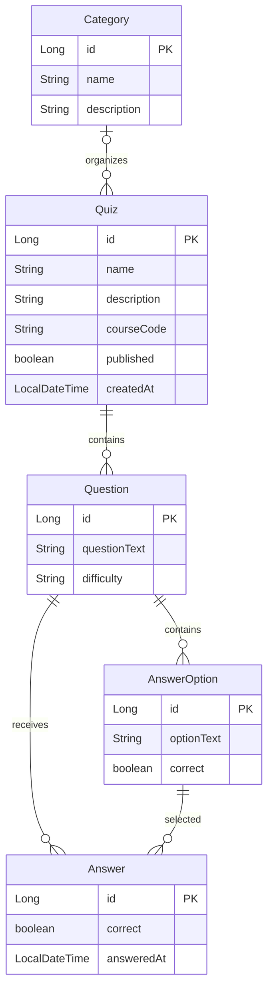

# Quizzer

Quizzer is an educational quiz application developed as part of the Haaga-Helia Software Development Project.

Teachers can create and manage multiple-choice quizzes, organize them into categories, add questions and answer options, and publish quizzes for students.

Students can browse published quizzes, filter them by category, answer questions, receive immediate feedback, and view their quiz results.

**Live applications**

- [Student Dashboard](https://quizzer-47kc.onrender.com/)
- [Teacher Dashboard](https://quizzer-git-quizzer001.2.rahtiapp.fi/)

## Team Members

- [Rebecca Paarent](https://github.com/reb-paarent)
- [Tuan Doan](https://github.com/manhtuandoan0410)
- [Dipen Rajbanshi](https://github.com/Dipen-Rajbanshi)
- [Polina Emelianova](https://github.com/pe010101)

[Quizzer Project Backlog](https://github.com/orgs/the-one-team-1/projects/2)

## Sprint Retrospectives

- [Sprint 1](https://edu.flinga.fi/s/EZSPN9H)

## Features

### Student Interface

- Browse published quizzes.
- Filter quizzes by category.
- Browse available quiz categories.
- Take multiple-choice quizzes, one question at a time.
- Receive immediate feedback on whether an answer is correct.
- View a personal score summary after completing a quiz.
- View aggregated quiz statistics, including total answers and correct and incorrect answers per question.

### Teacher Interface

- Create, edit, and delete quizzes.
- Publish and unpublish quizzes.
- Add and delete questions.
- Add, edit, and delete answer options.
- Manage quiz categories.
- View aggregated quiz results and statistics.

## Data Model

The application's data model consists of the following entities:

- **Category:** Represents a group of related quizzes. Each category has a unique ID, name, and description. A category can contain multiple quizzes.
- **Quiz:** Represents a quiz with a unique ID, name, description, course code, publication status, and creation timestamp. A quiz can contain multiple questions and can belong to zero or one category.
- **Question:** Represents a question within a quiz. Each question has a unique ID, question text, and difficulty level. A question belongs to one quiz and can contain multiple answer options.
- **Answer Option:** Represents an available answer for a question. Each option has a unique ID, option text, and a boolean value indicating whether it is correct.
- **Answer:** Represents an answer submitted by a quiz taker. It stores the selected answer, creation time, and whether the answer was correct.

### Entity Relationship Diagram



## Development Approach

The project is developed incrementally through sprints. Each sprint introduces new features and improvements based on the Product Owner's requirements and the team's backlog.

## Technologies

### Backend

- Java 21
- Spring Boot
- Spring MVC
- Spring Data JPA
- Maven
- Thymeleaf
- H2 Database (development)
- PostgreSQL (production)

### Frontend

- React
- TypeScript
- Vite
- React Router

## Project Status

Sprint 2 release preparation.

## Definition of Done

- Agreed tasks are complete.
- All team members have tested the application and confirmed that no errors were found.
- The Product Owner has approved the implementation.
- No accessible placeholder pages or unfinished content remain.
- The backlog is updated.
- The application is deployed to production.
- Project documentation is updated.

## Developer Guide

### Prerequisites

- Java 21 or higher.
- Git.
- Node.js 20 or newer.
- npm (included with Node.js).

A separate Maven installation is not required because the project includes the Maven Wrapper.

### 1. Clone the Repository

```bash
git clone https://github.com/the-one-team-1/Quizzer.git
cd Quizzer
```

### 2. Start the Backend

**Windows (PowerShell):**

```powershell
.\mvnw.cmd spring-boot:run
```

**macOS / Linux:**

```bash
chmod +x mvnw
./mvnw spring-boot:run
```

Once the backend has started, open:

http://localhost:8080

This opens the Teacher Dashboard.

### 3. Start the Frontend

Open a second terminal and navigate to the frontend directory:

```bash
cd frontend
```

Install dependencies:

```bash
npm ci
```

Create your local environment file from the example:

**Windows (PowerShell):**

```powershell
Copy-Item .env.example .env
```

**macOS / Linux:**

```bash
cp .env.example .env
```

The `.env` file should contain the backend URL:

```env
VITE_BACKEND_URL=http://localhost:8080
```

Start the frontend development server:

```bash
npm run dev
```

Open the Student Dashboard:

http://localhost:5173

The backend must also be running for the frontend to retrieve quiz data and submit answers.

### 4. Run Backend Tests

**Windows:**

```powershell
.\mvnw.cmd test
```

**macOS / Linux:**

```bash
./mvnw test
```

### 5. Build the Frontend

From the `frontend` directory:

```bash
npm run build
```

### Environment Configuration

The frontend uses the `VITE_BACKEND_URL` environment variable to connect to the backend.

- `.env` is used for local development.
- `.env.production` can be used for a local production build.
- `.env.example` provides the configuration template for developers.
- The production deployment uses the environment variable configured in the hosting platform.

Do not commit local environment files or put private secrets in Vite environment variables. Variables prefixed with `VITE_` are exposed to the browser.
