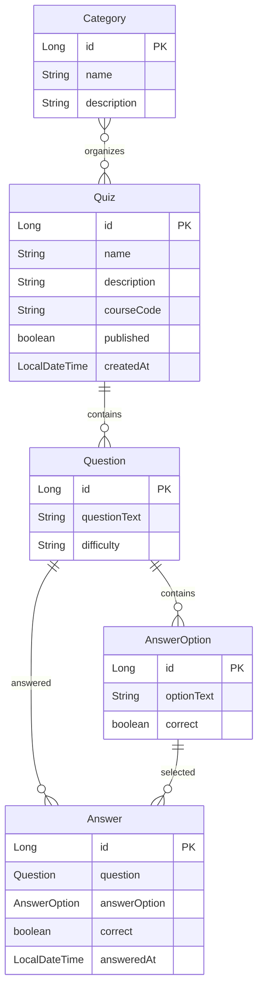

# Quizzer

Quizzer is an educational application for quizzes. Using the application, teachers can create and manage multiple choice quizzes for their classrooms. The application allows teachers to organize quizzes by category and assign them to students. Students are able to access quizzes and track their results.

**Production environment (backend):** https://quizzer-git-quizzer001.2.rahtiapp.fi/

## Team Members
[Rebecca Paarent](https://github.com/reb-paarent)
[Tuan Doan](https://github.com/manhtuandoan0410)
[Dipen Rajbanshi](https://github.com/Dipen-Rajbanshi)
[Polina Emelianova](https://github.com/pe010101)

[Quizzer project backlog](https://github.com/orgs/the-one-team-1/projects/2)

## Sprint Retrospectives
[Sprint 1]( https://edu.flinga.fi/s/EZSPN9H )

## Features

### Student interface 
- View published quizzes
- Take multiple-choice quizzes
- Get instant feedback on whether an answer was correct *(planned)*
- View quiz results: total answers, correct answer percentage, and correct/wrong counts per question
- Write, edit and delete quiz reviews, and read other students' reviews *(planned)*


### Teacher interface
- Create, edit and delete quizzes
- Add and delete questions
- Add, edit and delete answer options
- Manage quiz categories
- View quiz results

## Data Model

The application's data model consists of the following:
- `Category`: represents a group of related quizzes with a unique id, a name, and a description. Each category can have many quizzes.
- `Quiz`: represents a quiz which has a unique id, name, description, course code, boolean publication status, and a creation timestamp. Each quiz can have many questions. Each quiz can belong to only one category.
- `Question`: represents a question within a quiz containing a unique id, text content, and a difficulty setting. A question can have more than one answer option. Each question belongs to one quiz. Each question can have multiple answer options and answers.
- `Answer Option`: represents answer options for a quiz question including a unique id, text content, and a boolean value for whether or not it is correct.
- `Answer`: represents answers options selected by quiz takers and contains a unique id, the answer option selected, the question that it belongs to, creation time, and a boolean value for whether or not it is correct.



## Development Approach

The project is developed incrementally through Sprints. Each Sprint introduces new features based on the Product Owner's requirements.

## Technologies
- Java
- Spring Boot
- Maven 
- Thymeleaf
- H2 Database (development)
- PostgreSQL (production)

## Project status:
Under Developement

## Definition of done:
- Agreed upon tasks are complete.
- All team members confirm have tested the code and found no errors.
- The application is deployed to a production environment.
- Documentation is updated.

## Developer guide

## Prerequisities 
- **Java 21** or higher (configured in `pom.xml`).
- **Git** installed on your machine.
- No separate Maven installation is required — the project includes the Maven Wrapper (`./mvnw`).

### How to start the backend application

1. Clone the repository:
   ```bash
   git clone https://github.com/the-one-team-1/Quizzer.git
   cd Quizzer
   
2. Start the Spring Boot application:

   **macOS / Linux**

   ```bash
   chmod +x mvnw   # only needed the first time
   ./mvnw spring-boot:run
   ```

   **Windows (Command Prompt or PowerShell)**

   ```bash
   .\mvnw.cmd spring-boot:run
   ```

3. Once the application has started, open <http://localhost:8080> in your browser. You should see the Teacher Dashboard.

For the local student dashboard, run the frontend on `http://localhost:5173`.
The published-quiz endpoint allows requests from that origin; other frontend origins
require explicit CORS configuration.

### Run the tests

**macOS / Linux**

```bash
./mvnw test
```

**Windows**

```bash
.\mvnw.cmd test
```
## How to start the frontend application

You need [Node.js](https://nodejs.org/) (version 20 or newer). Run the commands in the `frontend` folder:

```bash
cd frontend
npm install
npm run dev
```

Then open http://localhost:5173. The backend must also be running at http://localhost:8080 (see the main README).
